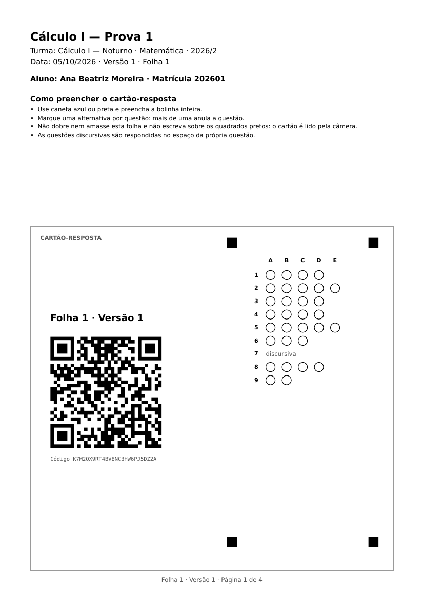

# Cartão-resposta

O cartão-resposta fica na primeira página de cada folha impressa. O PDF da aplicação (#46)
desenha o cartão, e a leitura da foto (#78) procura as marcações nas mesmas posições.

As medidas ficam num lugar só, `packages/domain/src/answer-card.ts` (`ANSWER_CARD`), e os dois
lados importam de lá. Nenhum dos dois guarda cópia: uma medida mudada de um lado só deixaria
toda folha impressa ilegível.

## Medidas

Em milímetros, a partir do canto superior esquerdo da página A4 em retrato (210 × 297), com `y`
crescendo para baixo.

| Elemento | Onde fica |
|---|---|
| Moldura | canto em x = 15 e y = 112, com 180 de largura e 170 de altura |
| Marcadores | quadrados pretos de 5 mm, com centro em (115, 120), (185, 120), (115, 268) e (185, 268) |
| Letras A a E | na altura y = 129, centradas sobre as colunas |
| Bolinhas | 20 linhas por 5 colunas, com raio de 2,3. A questão `n` (0 a 19) na letra `k` (0 = A até 4 = E) tem centro em x = 134 + 8k e y = 136 + 6,5n |
| Número da questão | `n + 1`, alinhado à direita em x = 128, na altura da linha |
| QR Code | quadrado de lado 55, com o canto em x = 25 e y = 166,5 |
| Folha e versão | "Folha N · Versão V", logo acima do QR Code |
| Código da folha | "Código …", logo abaixo do QR Code |

As funções `bubbleCenter(n, k)` e `columnLetter(k)` fazem essas contas, e recusam uma linha ou uma
letra que o cartão não tem.

## O que o QR Code carrega

O endereço da consulta pública da folha, `<PUBLIC_APP_URL>/r/<code>`, por exemplo
`https://correctio-app.web.app/r/K7M2QX9RT4BV8NC3HW6PJ5DZ2A`.

- O `code` é o `AnswerSheet.code`, de 26 caracteres, a única chave da folha
  (`docs/Seguranca_e_LGPD.md`, seção 3).
- A base vem da variável de ambiente `PUBLIC_APP_URL` da API, nunca do código, porque fica
  impressa no papel.
- A correção de erro é de nível M: o QR Code continua legível com até 15% dele manchado ou
  dobrado.

Pelo código se chega à folha, pela folha à versão (`examVersionId`) e pela versão ao `layout`,
que registra o que foi impresso.

## Como ler uma foto

1. Achar os quatro marcadores e o centro de cada um na foto.
2. Endireitar a foto com a transformação que leva esses quatro centros aos centros da tabela, em
   milímetros.
3. Ler o QR Code e, pelo código, chegar ao `layout` da versão da folha.
4. Montar as linhas com `answerCardRows(layout)`. A linha `n` é a questão
   `layout.questionOrder[n]`. A bolinha `k` dessa linha é a alternativa `printedOrder[k]` da
   entrada da questão em `layout.alternativeOrder`.
5. Em cada linha com bolinhas, medir o preenchimento em `bubbleCenter(n, k)`. Duas marcações na
   mesma linha anulam a questão, como diz a instrução impressa na capa.

Uma linha sem bolinhas é questão discursiva: aparece no cartão com o número e a palavra
"discursiva", e não é lida. As linhas depois da última questão ficam em branco. O espaço é sempre
de 20 linhas, o máximo de questões por prova, para todo cartão ter a mesma geometria.

A leitura usa o `layout`, e não a prova, de propósito: o `layout` é o que foi impresso, e a prova
pode ter mudado depois.

## Antes de mudar uma medida

- Mudar uma medida muda o PDF e a leitura ao mesmo tempo, mas não muda o papel já impresso. Depois
  da primeira prova aplicada em produção, mudar a geometria exige saber com qual geometria cada
  folha foi impressa.
- `packages/domain/src/__tests__/answer-card.test.ts` confere que o cartão cabe na página, que as
  bolinhas não se encostam e ficam dentro dos marcadores, e que o QR Code nunca cobre uma bolinha.

## O resto da folha

- A capa traz prova, turma, data, versão e folha. Quando a aplicação é identificada, traz também
  o nome e a matrícula do aluno; senão, linhas em branco para ele preencher.
- As questões começam na segunda página, na ordem do `layout` da versão, com as alternativas
  na ordem de `printedOrder`, de A a E.
- Questão nunca quebra entre páginas (RF43). Cada folha termina em número par de páginas,
  contando a capa, com uma página em branco quando precisa (RF44), para a folha seguinte não
  começar no verso.
- A fonte DejaVu vai embutida no PDF, para símbolos como →, ³ e √ saírem iguais em qualquer
  impressora.
