# Diagrama entidade-relacionamento (DER)

O banco MySQL da N2 **como as migrations o criam**: as tabelas, as colunas, os tipos e as chaves
que `apps/api/src/db/migrations` deixa no banco depois de `npm run db:migrate`. É diferente do
[diagrama de classes](../uml/class-diagram/class-diagram.puml), que mostra o domínio: aqui
aparecem as tabelas filhas, as colunas técnicas (`createdAt`, `updatedAt`) e o tipo de cada
coluna no MySQL.

O que cada coluna guarda está no [dicionário de dados](data-dictionary.md), com uma tabela por
entidade. O contrato que as tabelas seguem é o [Modelo de Dados](../Modelo_de_Dados.md).

Nada aqui foi desenhado à mão. O script `scripts/generate-er-diagram.mjs` lê o
`INFORMATION_SCHEMA` de um banco recém-migrado e escreve a fonte PlantUML da imagem e o bloco
Mermaid abaixo (ver [Como gerar de novo](#como-gerar-de-novo)).

## Imagem


Fonte da imagem: [er-diagram.puml](er-diagram.puml).

## Diagrama em Mermaid

A mesma informação em texto, que o GitHub desenha na própria página e que aparece no diff de
qualquer PR que mude o banco.

```mermaid
erDiagram
  activity_logs {
    VARCHAR(36) id PK
    VARCHAR(36) teacherId FK "NULL"
    VARCHAR(64) type
    VARCHAR(64) entity
    VARCHAR(36) entityId "NULL"
    JSON details "NULL"
    DATETIME(3) createdAt
  }
  answer_sheets {
    VARCHAR(36) id PK
    VARCHAR(36) applicationId FK
    VARCHAR(36) examVersionId FK
    VARCHAR(36) studentId FK "NULL"
    INT_UNSIGNED sheetNumber
    VARCHAR(32) code UK
    SMALLINT_UNSIGNED answerCardVersion
  }
  applications {
    VARCHAR(36) id PK
    VARCHAR(36) examId FK
    VARCHAR(36) classId FK
    VARCHAR(36) teacherId FK
    ENUM status "ENUM('draft','generated','closed')"
    VARCHAR(2048) pdfUrl "NULL"
    DATETIME(3) date
    TINYINT(1) gradesReleased
    DATETIME(3) createdAt
    DATETIME(3) updatedAt
  }
  auth_codes {
    VARCHAR(36) id PK
    VARCHAR(36) userId FK
    ENUM purpose "ENUM('PASSWORD_RESET','GOOGLE_SIGN_IN')"
    CHAR(64) codeHash UK
    DATETIME(3) expiresAt
    DATETIME(3) usedAt "NULL"
    DATETIME(3) createdAt
  }
  class_enrollments {
    VARCHAR(36) id PK
    VARCHAR(36) classId FK
    VARCHAR(36) studentId FK
    ENUM status "ENUM('active','removed')"
    ENUM enrolledVia "ENUM('teacher','invite_code')"
  }
  classes {
    VARCHAR(36) id PK
    VARCHAR(36) teacherId FK
    VARCHAR(120) name
    VARCHAR(120) subject
    VARCHAR(40) term
    ENUM status "ENUM('active','archived')"
    VARCHAR(32) inviteCode UK
    DATETIME(3) createdAt
    DATETIME(3) updatedAt
  }
  correction_discursive_scores {
    VARCHAR(36) correctionId PK, FK
    VARCHAR(36) questionId PK, FK
    DECIMAL score "DECIMAL(6,2)"
  }
  correction_objective_results {
    VARCHAR(36) correctionId PK, FK
    VARCHAR(36) questionId PK, FK
    TINYINT(1) correct
    DECIMAL score "DECIMAL(6,2)"
    VARCHAR(36) selectedAlternativeId "NULL"
  }
  corrections {
    VARCHAR(36) id PK
    VARCHAR(36) examVersionId FK
    VARCHAR(36) studentId FK "NULL"
    VARCHAR(160) reportedStudentName "NULL"
    VARCHAR(40) reportedStudentRegistration "NULL"
    DECIMAL totalScore "DECIMAL(7,2)"
    TEXT notes "NULL"
    DATETIME(3) confirmedAt
    VARCHAR(36) correctedBy FK
    TINYINT(1) isAutomaticallyAssigned
    VARCHAR(64) clientCorrectionId UK
    ENUM syncStatus "ENUM('pending','synced','error')"
    VARCHAR(36) answerSheetId FK, UK
    ENUM source "ENUM('IMAGE_UPLOAD','MANUAL')"
    ENUM status "ENUM('IN_PROGRESS','DONE')"
    VARCHAR(2048) imageUrl "NULL"
    DATETIME(3) createdAt
    DATETIME(3) updatedAt
  }
  exam_assignments {
    VARCHAR(36) id PK
    VARCHAR(36) examVersionId FK
    VARCHAR(36) studentId FK
    VARCHAR(512) qrCodePayload
  }
  exam_questions {
    VARCHAR(36) examId PK, FK
    VARCHAR(36) questionId PK, FK
    SMALLINT_UNSIGNED order
    DECIMAL score "DECIMAL(6,2)"
    TINYINT(1) allowShuffleAlternatives
  }
  exam_versions {
    VARCHAR(36) id PK
    VARCHAR(36) applicationId FK
    SMALLINT_UNSIGNED versionNumber
    TINYINT(1) shuffleQuestions
    TINYINT(1) shuffleAlternatives
    TINYINT(1) withStudentIdentification
    JSON layout
    TINYINT(1) answerKeyPublished
    DATETIME(3) answerKeyPublishedAt "NULL"
    VARCHAR(64) publicCode UK
    VARCHAR(512) qrCodePayload
  }
  exams {
    VARCHAR(36) id PK
    VARCHAR(36) teacherId FK
    VARCHAR(200) title
    ENUM status "ENUM('draft','ready','closed')"
    TEXT description
    TINYINT(1) defaultShuffleQuestions
    TINYINT(1) defaultShuffleAlternatives
    DATETIME(3) createdAt
    DATETIME(3) updatedAt
  }
  question_alternatives {
    VARCHAR(36) questionId PK, FK
    VARCHAR(36) id PK
    TEXT text
    TINYINT_UNSIGNED position
  }
  question_tags {
    VARCHAR(36) questionId PK, FK
    VARCHAR(80) tag PK
  }
  questions {
    VARCHAR(36) id PK
    VARCHAR(36) teacherId FK
    ENUM type "ENUM('objetiva','discursiva')"
    TEXT statement
    VARCHAR(36) correctAlternativeId "NULL"
    DECIMAL maxScore "DECIMAL(6,2) NULL"
    DATETIME(3) deletedAt "NULL"
    TINYINT(1) allowShuffleAlternatives
    DATETIME(3) createdAt
    DATETIME(3) updatedAt
  }
  refresh_tokens {
    VARCHAR(36) id PK
    VARCHAR(36) userId FK
    CHAR(64) tokenHash UK
    VARCHAR(255) deviceInfo "NULL"
    DATETIME(3) issuedAt
    DATETIME(3) expiresAt
    DATETIME(3) revokedAt "NULL"
  }
  sheet_images {
    VARCHAR(36) id PK
    VARCHAR(36) applicationId FK
    VARCHAR(36) teacherId FK
    VARCHAR(255) storageKey
    VARCHAR(32) contentType
    INT_UNSIGNED byteSize
    VARCHAR(24) status
    VARCHAR(36) answerSheetId "NULL"
    DATETIME(3) createdAt
  }
  students {
    VARCHAR(36) id PK
    VARCHAR(36) classId FK
    VARCHAR(160) fullName
    VARCHAR(40) registration
    VARCHAR(512) email "NULL"
    DATETIME(3) anonymizedAt "NULL"
    VARCHAR(36) userId FK "NULL"
    DATETIME(3) removedAt "NULL"
    DATETIME(3) createdAt
    DATETIME(3) updatedAt
  }
  users {
    VARCHAR(36) id PK
    ENUM role "ENUM('professor','estudante')"
    VARCHAR(160) fullName
    VARCHAR(254) email UK
    VARCHAR(255) passwordHash
    DATETIME(3) createdAt
    DATETIME(3) anonymizedAt "NULL"
    DATETIME(3) emailVerifiedAt "NULL"
    DATETIME(3) updatedAt
  }
  users |o..o{ activity_logs : teacherId
  applications ||..o{ answer_sheets : applicationId
  exam_versions ||..o{ answer_sheets : examVersionId
  students |o..o{ answer_sheets : studentId
  exams ||..o{ applications : examId
  classes ||..o{ applications : classId
  users ||..o{ applications : teacherId
  users ||..o{ auth_codes : userId
  classes ||..o{ class_enrollments : classId
  users ||..o{ class_enrollments : studentId
  users ||..o{ classes : teacherId
  corrections ||--o{ correction_discursive_scores : correctionId
  questions ||--o{ correction_discursive_scores : questionId
  corrections ||--o{ correction_objective_results : correctionId
  questions ||--o{ correction_objective_results : questionId
  exam_versions ||..o{ corrections : examVersionId
  students |o..o{ corrections : studentId
  users ||..o{ corrections : correctedBy
  answer_sheets ||..o| corrections : answerSheetId
  exam_versions ||..o{ exam_assignments : examVersionId
  users ||..o{ exam_assignments : studentId
  exams ||--o{ exam_questions : examId
  questions ||--o{ exam_questions : questionId
  applications ||..o{ exam_versions : applicationId
  users ||..o{ exams : teacherId
  questions ||--o{ question_alternatives : questionId
  questions ||--o{ question_tags : questionId
  users ||..o{ questions : teacherId
  users ||..o{ refresh_tokens : userId
  applications ||..o{ sheet_images : applicationId
  users ||..o{ sheet_images : teacherId
  classes ||..o{ students : classId
  users |o..o{ students : userId
```

<!-- er-diagram:start -->

<!-- er-diagram:end -->

## Como ler

| No diagrama | Significado |
|---|---|
| `PK` | chave primária; nas tabelas filhas, composta pelas colunas marcadas |
| `FK` | chave estrangeira; o rótulo da linha é o nome da coluna |
| `UK` | coluna única |
| `NULL` | coluna opcional; as demais são `NOT NULL` |
| `\|\|` | exatamente um registro do outro lado |
| `\|o` | zero ou um: a chave estrangeira aceita `NULL` |
| `o{` | zero ou muitos |
| `o\|` | zero ou um do lado filho: a chave estrangeira é única (`corrections.answerSheetId`) |
| linha contínua | a chave estrangeira faz parte da chave primária: a linha filha não existe sem a mãe |
| linha tracejada | chave estrangeira comum |

Pontos que o diagrama mostra e que vale saber antes de ler:

- **As listas do modelo viraram tabelas filhas** quando são referenciadas ou entram em relatório:
  `question_alternatives` e `question_tags` (de `Question`), `exam_questions` (de
  `Exam.questions`), `correction_objective_results` e `correction_discursive_scores` (de
  `Correction`). `ExamVersion.layout` ficou em `JSON`, porque é um retrato gravado uma vez e lido
  inteiro.
- **`class_enrollments` e `exam_assignments` estão reservadas para escopo futuro**, a área do
  aluno. Aparecem sem uso, como `students.userId` e `classes.inviteCode`, e não podem ser
  apagadas (ver "Reservado para escopo futuro" no [Modelo de Dados](../Modelo_de_Dados.md)).
- **Nenhuma chave estrangeira apaga em cascata.** Remover é sempre arquivar, pelo campo de cada
  entidade: `questions.deletedAt`, `classes.status = 'archived'`, `exams.status = 'closed'`,
  `applications.status = 'closed'` e `students.removedAt`.
- **`TINYINT(1)` é booleano.** É como o MySQL guarda `BOOLEAN`; a API devolve `true` e `false`.

## Como gerar de novo

Toda migration nova que mude tabela ou coluna regera os dois diagramas no mesmo PR:

```bash
docker compose up -d mysql                # MySQL 8.4 local
npm run db:migrate                        # aplica as migrations no banco do apps/api/.env
npm run docs:er-diagram                   # reescreve er-diagram.puml e o bloco Mermaid desta página
java -jar plantuml.jar -tpng docs/data-model/er-diagram.puml
```

O `docs:er-diagram` só lê: consulta o `INFORMATION_SCHEMA` do banco de `DATABASE_URL` (o do
`apps/api/.env`) e ignora as tabelas internas do Kysely (`kysely_migration` e
`kysely_migration_lock`). Ele também confere o [dicionário de dados](data-dictionary.md): termina
com erro e lista o que falta quando o banco tem uma coluna que o dicionário não descreve, ou
quando o dicionário ainda descreve uma coluna que saiu do banco. A descrição de cada coluna
continua escrita à mão.

A imagem desta versão foi gerada com o PlantUML 1.2025.8 (o `plantuml.jar` de
[plantuml.com/download](https://plantuml.com/download)), com o layout Smetana, que vem dentro do
jar: basta o Java, sem instalar o Graphviz.
