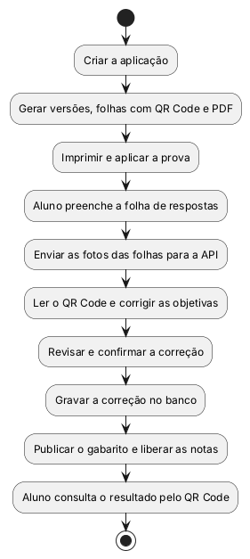
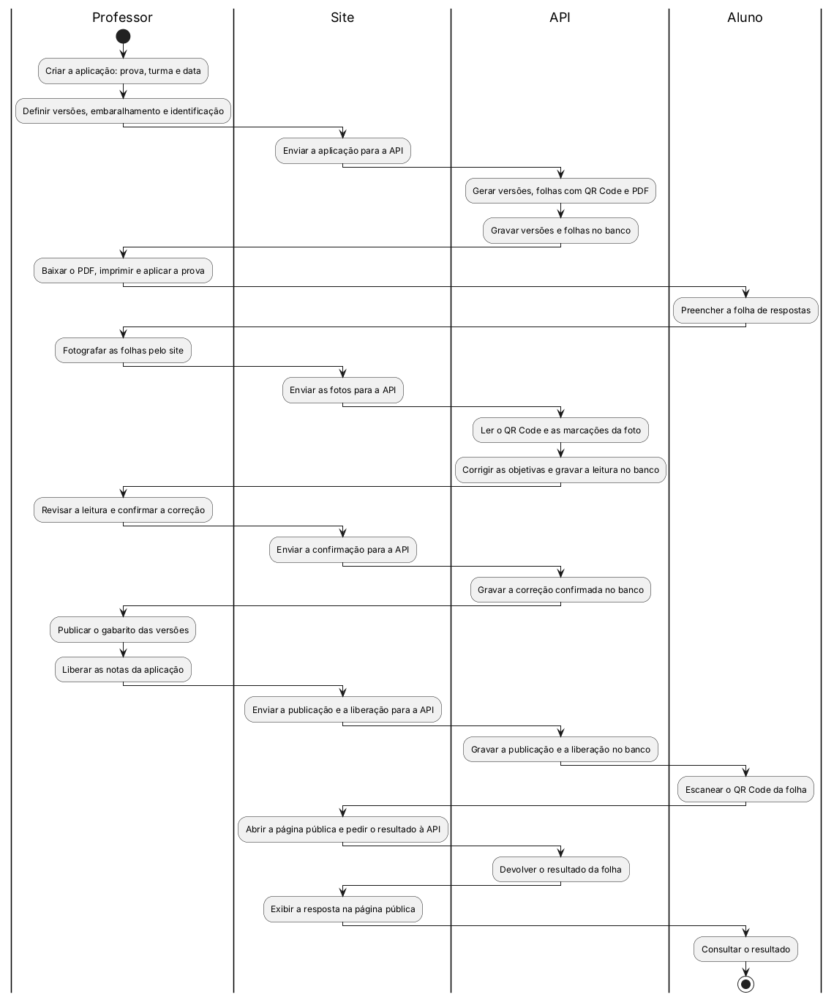
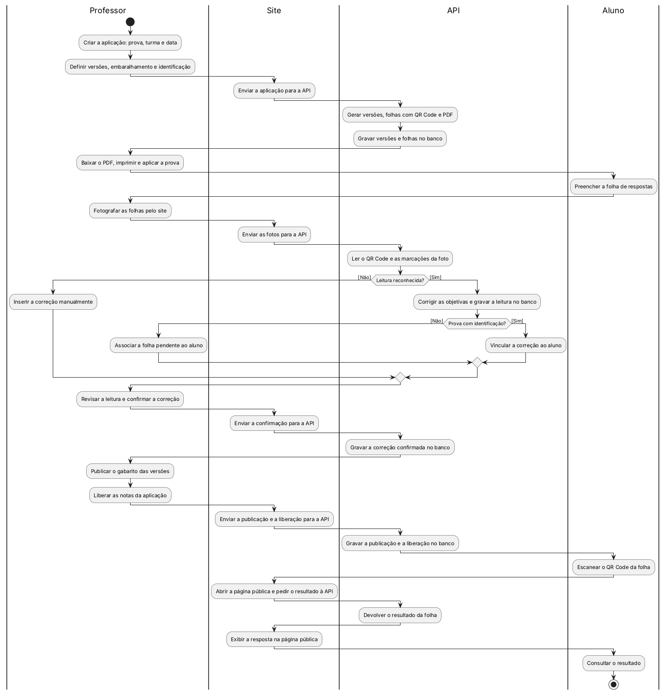
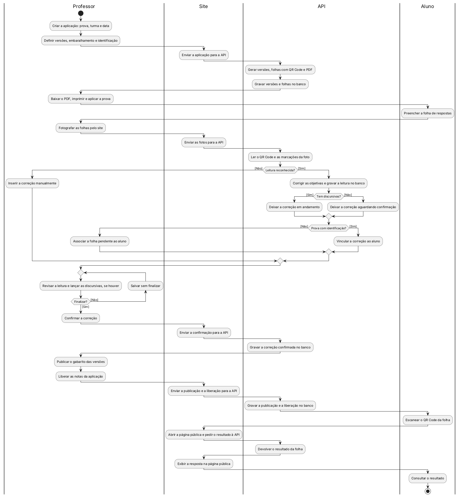
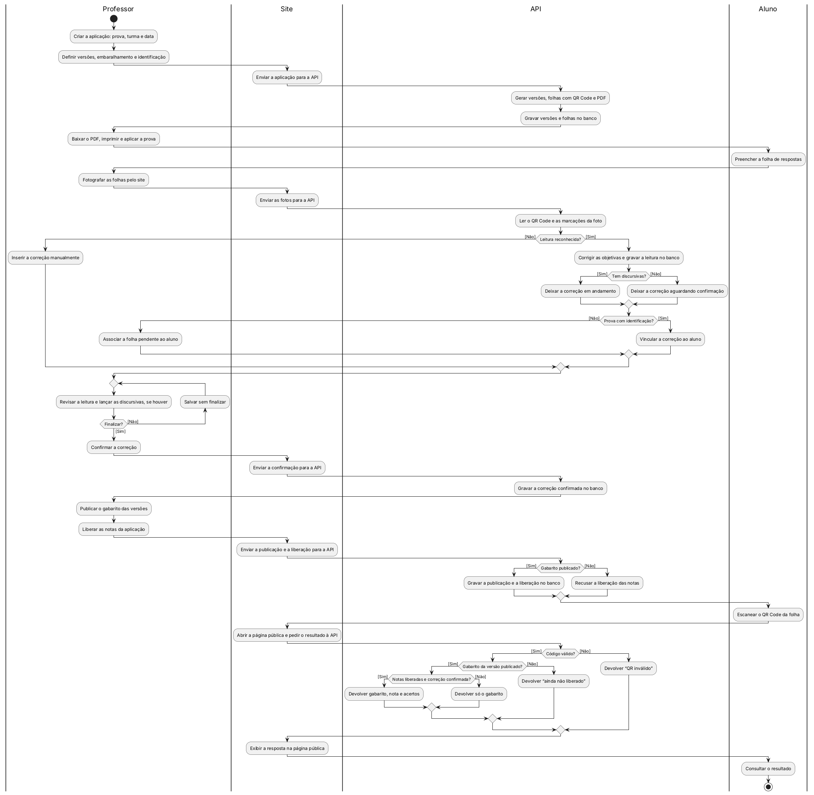

# Diagrama de Atividades — Correctio

> Atividade N2 · Projeto e Arquitetura de Software · Grupo 2 · Católica SC
>
> Fonte dos requisitos: [Correctio_Requisitos_e_Telas.md](../Correctio_Requisitos_e_Telas.md)
> (RF26 a RF33, RF46, RF47, RNF07 e as telas P14, P15, P16, P17 e PUB1). Se um desses
> requisitos mudar lá, este diagrama precisa ser revisto.
>
> Fonte do desenho: [activity-diagram.puml](activity-diagram.puml), em PlantUML. As etapas
> do Passo 4 estão em [activity-diagram-steps.puml](activity-diagram-steps.puml).

O diagrama de atividades responde a uma pergunta: **em que ordem as coisas acontecem e quem
faz cada uma**. O diagrama de casos de uso mostra quem usa o sistema e para quê; o de
sequência mostra as mensagens trocadas entre as partes do sistema. Este fica no meio: segue
um processo do começo ao fim, com as decisões, os desvios e o responsável por cada passo.

A versão da N1 está no `Diagrama de atividade.docx`, anexado na issue
[#27](https://github.com/PrieTorres/correctio-app/issues/27). Este documento é a versão da
N2: o mesmo processo, agora com a foto passando pela API e a correção gravada no MySQL.

---

## Passo 1 — Definir o cenário

O diagrama segue um cenário só, o mais importante do produto: a vida de uma prova, da
criação até a nota chegar ao aluno.

> **Cenário base:** o professor cria a aplicação da prova para uma turma, gera e imprime as
> versões embaralhadas, com um QR Code em cada folha, e corrige fotografando as folhas pelo
> site, que as envia para a API; a API lê as folhas e grava a correção no banco. Depois que o
> professor publica o gabarito e libera as notas, o aluno vê o resultado escaneando o QR Code
> da própria folha, sem login.

---

## Passo 2 — Listar o fluxo em ordem

Antes de desenhar, listamos o processo na ordem em que ele acontece na N2. Na N1, tudo rodava
no navegador, e o PDF e a leitura da foto eram simulados. Na N2, o site manda os dados para a
API, a API grava no MySQL, o PDF é gerado de verdade e a leitura do QR Code e das marcações é
real. No diagrama da N1, três pontos deste fluxo eram tracejados, porque estavam nos
requisitos, mas ainda não no código. Na N2, cada um deles tem uma issue que o implementa, e por
isso todos aparecem com linha cheia (veja a legenda no Passo 5).

1. O Professor cria a aplicação, escolhendo a prova, a turma e a data.
2. O Professor define o número de versões, o embaralhamento (herdado da prova) e se a prova
   terá identificação.
3. O Site envia a aplicação para a API, que gera as versões, uma folha por aluno com QR Code
   único e o PDF, e grava as versões e as folhas no banco.
4. O Professor baixa o PDF, imprime e aplica a prova, e o Aluno preenche a folha de respostas.
5. O Professor fotografa as folhas pelo site, e o Site envia as fotos para a API.
6. A API lê o QR Code e as marcações da foto.
7. **Decisão:** a leitura foi reconhecida?
   - **[Não]** → o Professor insere a correção manualmente (RF30) e segue para o passo 10.
   - **[Sim]** → a API corrige as objetivas e grava a leitura no banco.
8. **Decisão:** a prova tem discursivas?
   - **[Sim]** → a correção fica em andamento até o Professor lançar as notas (RF47).
   - **[Não]** → a correção fica aguardando a confirmação do Professor.
9. **Decisão:** a prova tem identificação?
   - **[Sim]** → a API vincula a correção ao aluno da folha.
   - **[Não]** → a folha fica pendente, e o Professor a associa ao aluno (RF31).
10. O Professor revisa a leitura e lança as notas das discursivas, se houver.
11. **Decisão:** finalizar a correção?
    - **[Não]** → o Professor salva sem finalizar e volta depois ao passo 10.
    - **[Sim]** → o Professor confirma a correção.
12. O Site envia a confirmação para a API, que grava a correção confirmada no banco. Só a
    partir daqui a nota pode chegar ao aluno (RNF07).
13. O Professor publica o gabarito das versões e libera as notas da aplicação, e o Site envia
    a publicação e a liberação para a API.
14. **Decisão:** o gabarito está publicado? A tela P14 só libera as notas depois disso.
    - **[Sim]** → a API grava a publicação e a liberação no banco.
    - **[Não]** → a API recusa a liberação das notas.
15. O Aluno escaneia o QR Code da folha, e o Site abre a página pública, sem login, e pede o
    resultado à API.
16. **Decisão:** o código é válido?
    - **[Não]** → a API devolve "QR inválido".
    - **[Sim]** → segue para o passo 17.
17. **Decisão:** o gabarito da versão foi publicado?
    - **[Não]** → a API devolve "ainda não liberado".
    - **[Sim]** → segue para o passo 18.
18. **Decisão:** as notas foram liberadas e a correção foi confirmada?
    - **[Não]** → a API devolve só o gabarito.
    - **[Sim]** → a API devolve o gabarito, a nota e os acertos.
19. O Site exibe a resposta na página pública, e o Aluno consulta o resultado (fim).

---

## Passo 3 — Identificar as raias

Cada atividade pertence a um responsável, por isso o diagrama usa raias, uma coluna para cada
um. Na N1, eram três: Professor, Sistema Web e Aluno. Na N2, a raia "Sistema Web" foi dividida
em **Site** e **API**, porque agora são duas partes separadas, e é na passagem de uma para a
outra que o dado sai do navegador e chega ao banco.

| Raia          | Quem é                                                  | Responsabilidades                                                                                                                                                                                                                                                                                                                     |
| ------------- | ------------------------------------------------------- | ------------------------------------------------------------------------------------------------------------------------------------------------------------------------------------------------------------------------------------------------------------------------------------------------------------------------------------- |
| **Professor** | Único usuário com login                                 | Criar a aplicação; definir versões, embaralhamento e identificação; baixar o PDF, imprimir e aplicar a prova; fotografar as folhas pelo site; inserir a correção manualmente quando a leitura falha; associar a folha pendente ao aluno; revisar, lançar as discursivas e confirmar a correção; publicar o gabarito; liberar as notas |
| **Site**      | O front-end em React, aberto no navegador               | Enviar para a API a aplicação, as fotos, a confirmação, a publicação e a liberação; abrir a página pública do QR Code e exibir a resposta da API                                                                                                                                                                                      |
| **API**       | O back-end em Express, a única parte que acessa o MySQL | Gerar versões, folhas com QR Code e PDF; ler o QR Code e as marcações; corrigir as objetivas; controlar o status da correção; vincular a correção ao aluno; gravar tudo no banco; decidir o que a página pública mostra; recusar a liberação das notas sem gabarito publicado                                                         |
| **Aluno**     | Não tem conta; é um registro dentro da turma            | Preencher a folha de respostas; escanear o QR Code da folha; consultar o resultado                                                                                                                                                                                                                                                    |

**Por que o banco não é uma raia:** o MySQL não toma decisões nem começa atividades; ele só
guarda o que a API manda gravar. Por isso aparece no nome das atividades da API ("Gravar a
correção confirmada no banco"), e não como uma coluna. As mensagens trocadas entre site, API e
banco, uma a uma, ficam para o diagrama de sequência
([#29](https://github.com/PrieTorres/correctio-app/issues/29)).

**Por que não há raia de app:** o app mobile saiu do escopo. O professor fotografa as folhas
pelo próprio site, que no celular abre a câmera direto (tela P15).

---

## Passo 4 — Desenhar em etapas

O diagrama foi montado aos poucos, uma ideia por vez, para que cada desvio entre no lugar
certo. Cada etapa acrescenta algo à anterior.

### Etapa 1 — Caminho principal

Primeiro desenhamos o caminho principal em uma linha só, do início ao fim, sem separar quem
faz o quê.



### Etapa 2 — Raias

Separamos as atividades em raias, uma para cada responsável: Professor, Site, API e Aluno.
Toda vez que o fluxo passa do Site para a API, um dado sai do navegador, e as atividades
"Gravar … no banco" mostram onde ele fica guardado.



### Etapa 3 — Leitura e identificação

Incluímos os dois desvios da leitura. Se a API não reconhece a folha (QR Code ilegível, por
exemplo), o professor insere a correção manualmente (RF30). Se reconhece, a nota é calculada,
mas só vai sozinha para o aluno quando a prova tem identificação; sem identificação, a folha
fica pendente até o professor associá-la ao aluno (RF31).



### Etapa 4 — Discursivas e confirmação

Depois incluímos as questões discursivas. Com elas, a correção fica em andamento até o
professor lançar as notas (RF29 e RF47); sem elas, fica aguardando a confirmação. Nos dois
casos, o professor pode salvar sem finalizar e voltar depois, e a nota só vale quando ele
confirma a correção (RNF07).



### Etapa 5 — Publicação e consulta pelo QR Code

Por fim, incluímos a publicação do gabarito, a liberação das notas e os quatro resultados
possíveis da página do QR Code (PUB1), todos decididos pela API. A API só libera as notas
quando o gabarito está publicado (P14). Esta é a versão final.



---

## Passo 5 — Ler a legenda

| Traço       | Significado                                      |
| ----------- | ------------------------------------------------ |
| Linha cheia | Faz parte da N2.                                 |
| Tracejado   | Previsto nos requisitos, ainda não existe na N2. |

Na N1, três pontos eram tracejados. Na N2, os três passam para linha cheia, porque cada um
tem uma issue da N2 que o implementa. Por isso, a versão da N2 não tem nenhum ponto tracejado.

| Ponto tracejado na N1                                                                        | Na N2                                                            | Quem implementa                                                                                                                                                                                                              |
| -------------------------------------------------------------------------------------------- | ---------------------------------------------------------------- | ---------------------------------------------------------------------------------------------------------------------------------------------------------------------------------------------------------------------------- |
| "Leitura reconhecida?" e "Inserir a correção manualmente" (RF30)                             | Linha cheia                                                      | [#78](https://github.com/PrieTorres/correctio-app/issues/78) (folha com QR Code ilegível segue para a correção manual) e [#48](https://github.com/PrieTorres/correctio-app/issues/48) (botão "Inserir correção manualmente") |
| "Correção confirmada e concluída?": nota só depois da confirmação do professor (RNF07, RF47) | Linha cheia, na decisão "Notas liberadas e correção confirmada?" | [#47](https://github.com/PrieTorres/correctio-app/issues/47)                                                                                                                                                                 |
| "Gabarito publicado?" antes de liberar as notas (tela P14)                                   | Linha cheia                                                      | [#46](https://github.com/PrieTorres/correctio-app/issues/46) ("Liberar notas" fica bloqueado enquanto o gabarito da versão não for publicado, na tela P14 e no servidor)                                                     |

**Se alguma dessas issues não entrar na N2,** o ponto dela volta a ficar tracejado, e a
legenda passa a valer para ele: previsto, ainda não existe na N2. O apêndice mostra como
tracejar um ponto no PlantUML.

### O que mudou da N1 para a N2

| Na N1                                                                          | Na N2                                                                              | Onde                                                                                                                                  |
| ------------------------------------------------------------------------------ | ---------------------------------------------------------------------------------- | ------------------------------------------------------------------------------------------------------------------------------------- |
| Uma raia "Sistema Web" fazia tudo no navegador, com os dados no `localStorage` | Raias "Site" e "API"; o dado passa pela API e é gravado no MySQL                   | [#94](https://github.com/PrieTorres/correctio-app/pull/94) e [#96](https://github.com/PrieTorres/correctio-app/pull/96), já na `main` |
| PDF simulado                                                                   | PDF gerado pela API, com as versões e as folhas gravadas no banco                  | [#46](https://github.com/PrieTorres/correctio-app/issues/46)                                                                          |
| Leitura da foto simulada, que nunca falhava                                    | Leitura real do QR Code e das marcações; folha ilegível vai para a correção manual | [#78](https://github.com/PrieTorres/correctio-app/issues/78)                                                                          |
| A correção ficava no `localStorage`                                            | O site envia a foto para a API, e a correção é gravada no banco                    | [#47](https://github.com/PrieTorres/correctio-app/issues/47) e [#48](https://github.com/PrieTorres/correctio-app/issues/48)           |
| A nota aparecia mesmo com a correção em andamento                              | A nota só aparece depois da confirmação do professor                               | [#47](https://github.com/PrieTorres/correctio-app/issues/47)                                                                          |
| "Liberar notas" funcionava mesmo sem o gabarito publicado                      | A liberação fica bloqueada até o gabarito ser publicado, na tela e na API          | [#46](https://github.com/PrieTorres/correctio-app/issues/46)                                                                          |
| A página do QR Code lia o `localStorage`                                       | A página pública pede o resultado à API                                            | [#49](https://github.com/PrieTorres/correctio-app/issues/49)                                                                          |

---

## Passo 6 — Revisar o diagrama

Checklist usado para conferir o resultado antes de fechar:

- [x] Há um nó inicial e um nó final, e todo caminho chega ao fim.
- [x] Toda atividade começa com verbo no infinitivo e fica na raia de quem a executa.
- [x] Toda decisão tem as guardas [Sim] e [Não], e os caminhos se juntam de novo antes de
      seguir.
- [x] O laço "Salvar sem finalizar" volta para a revisão, sem repetir o envio da foto.
- [x] Quem grava no banco é sempre a API, e o nome da atividade diz isso.
- [x] A legenda diz o que era tracejado na N1 e qual issue da N2 implementa cada ponto.
- [x] O fluxo cobre RF26 a RF33, RF46, RF47, RNF07 e as telas P14, P15, P16, P17 e PUB1.

---

## Apêndice — Como editar e gerar as imagens

As imagens são geradas a partir dos arquivos `.puml`. Para mudar o diagrama, edite o `.puml`
e gere as imagens de novo; não edite os `.png` à mão. Se a mudança alterar o fluxo, atualize
também o texto deste documento.

| Arquivo                       | O que gera                                                                     |
| ----------------------------- | ------------------------------------------------------------------------------ |
| `activity-diagram.puml`       | O diagrama final (etapa 5): `activity-diagram.png`                             |
| `activity-diagram-steps.puml` | As etapas 1 a 4: `activity-diagram-step-1.png` a `activity-diagram-step-4.png` |

Com Java instalado e o `plantuml.jar` baixado de [plantuml.com/download](https://plantuml.com/download):

```bash
java -jar plantuml.jar -tpng docs/uml/activity-diagram.puml docs/uml/activity-diagram-steps.puml
```

Também dá para usar a extensão PlantUML do VS Code ou colar o código em
[plantuml.com/plantuml](https://www.plantuml.com/plantuml). As imagens desta versão foram
geradas com o PlantUML 1.2025.8; versões antigas, como a 1.2022, não aplicam o estilo do
tracejado.

Notação do PlantUML usada nos arquivos:

| No diagrama | No PlantUML                                                                                |
| ----------- | ------------------------------------------------------------------------------------------ |
| Raia        | `\|Professor\|`, antes das atividades daquela raia                                         |
| Atividade   | `:Enviar as fotos para a API;`                                                             |
| Decisão     | `if (Leitura reconhecida?) then ([Não]) … else ([Sim]) … endif`                            |
| Laço        | `repeat … backward:Salvar sem finalizar; repeat while (Finalizar?) is ([Não]) not ([Sim])` |

Para tracejar um ponto que a N2 deixar de fora, acrescente `<<planned>>` no fim da atividade
(por exemplo, `:Inserir a correção manualmente; <<planned>>`) e coloque `-[dashed]->` na linha
antes e na linha depois dela. O estilo `.planned`, que desenha a caixa tracejada, já está
declarado no começo do `activity-diagram.puml`. Depois, gere as imagens de novo e atualize a
legenda do Passo 5.
