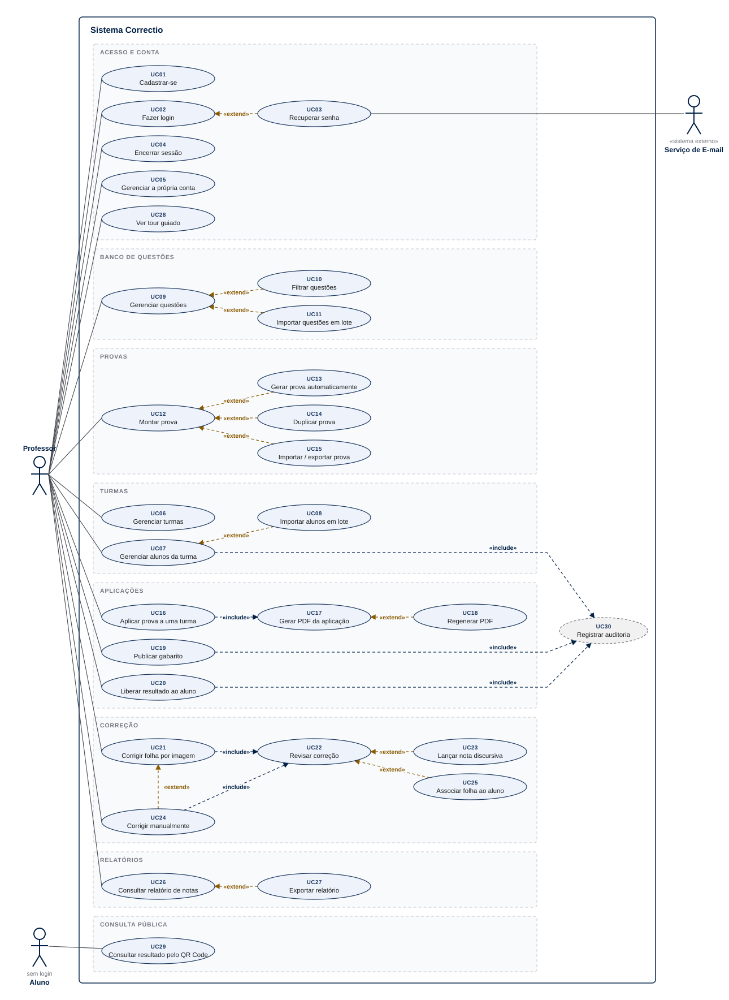
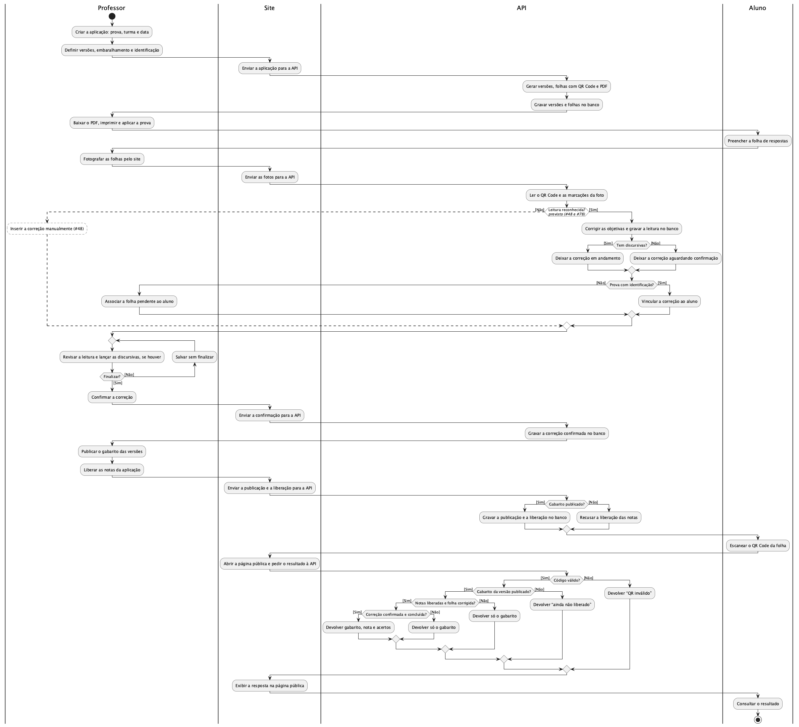
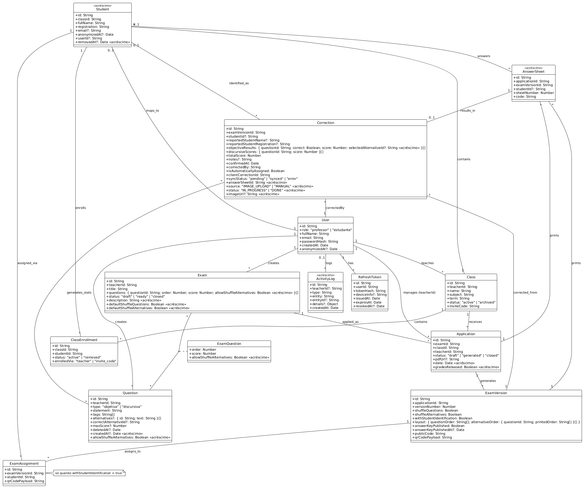
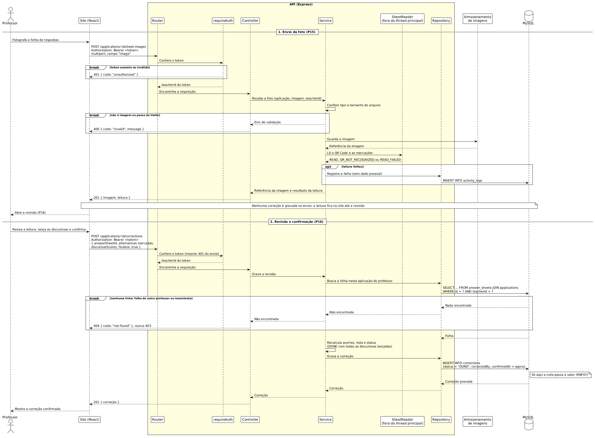
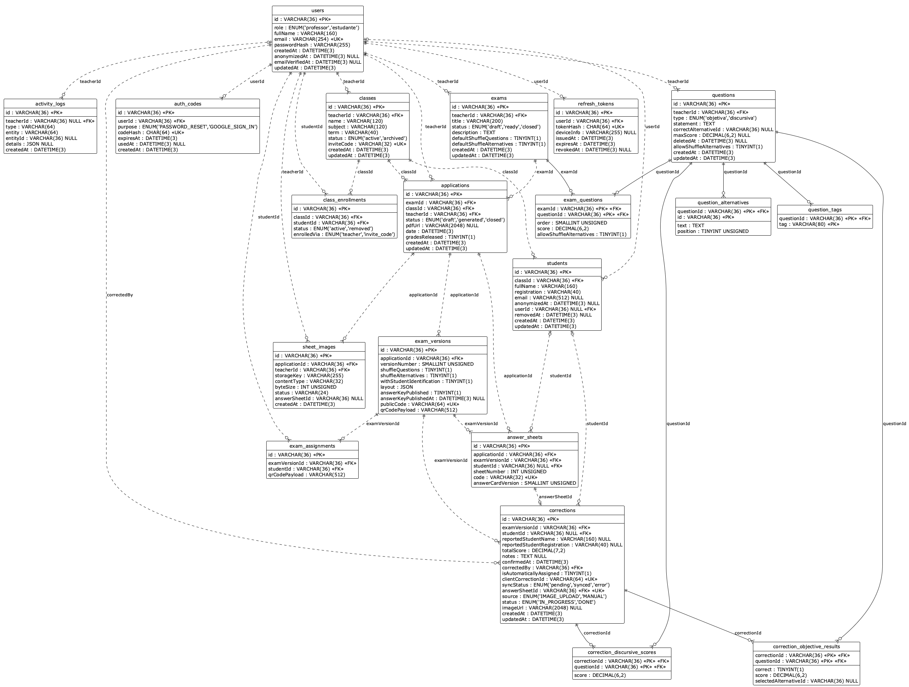

<div align="center">

# 📄 Correctio

**Plataforma web onde o professor monta a prova uma vez, imprime versões embaralhadas com QR Code, corrige fotografando as folhas de resposta e devolve a nota ao aluno pelo próprio QR.**

`Projeto e Arquitetura de Software` · `Grupo 2` · `Católica SC`

`React` · `Vite` · `Node.js` · `Express` · `MySQL`

**🌐 Sistema hospedado: [correctio-app.web.app](https://correctio-app.web.app)**

</div>

---

## 👥 Equipe

| Nome completo | E-mail institucional | GitHub | Papel e principais frentes |
|---|---|---|---|
| Priscila Torres Benedito de Paula | priscila.paula@catolicasc.edu.br | [@PrieTorres](https://github.com/PrieTorres) | PM e code owner. Infraestrutura, API base, banco, CI/CD e publicação, autenticação, leitura da folha, ADRs, revisão de código |
| Heloísa Fogaça do Nascimento | h.nascimento@catolicasc.edu.br | [@heloisaFogaca](https://github.com/heloisaFogaca) | Acesso e consulta pública pelo QR, painel, contato com a professora (PO), diagrama de casos de uso |
| Jeliel Nunes da Silva | jeliel.silva@catolicasc.edu.br | [@Jeliell](https://github.com/Jeliell) | Turmas e alunos, aplicações e PDF, diagrama de atividades |
| Cleberson Luis Vieira Martins Maia | cleberson.maia@catolicasc.edu.br | [@maia202](https://github.com/maia202) | Banco de questões e provas, testes, revisão de UX, diagramas de classe e de sequência |
| Fabricio da Silva Junior | fabricio94.silva@catolicasc.edu.br | [@fabriciojrr](https://github.com/fabriciojrr) | Frente planejada na N2: correção, painel e relatórios (ver seção 14) |

**Board de tarefas:** [GitHub Project 4](https://github.com/users/PrieTorres/projects/4)

## 📑 Sumário

1. [Visão Geral](#1-visão-geral)
2. [Requisitos](#2-requisitos)
3. [Modelagem (UML)](#3-modelagem-uml)
4. [Telas do Sistema](#4-telas-do-sistema)
5. [Arquitetura de Software](#5-arquitetura-de-software)
6. [Decisões Arquiteturais (ADRs)](#6-decisões-arquiteturais-adrs)
7. [Modelo de Dados](#7-modelo-de-dados)
8. [Stack Tecnológica](#8-stack-tecnológica)
9. [Estrutura de Pastas](#9-estrutura-de-pastas)
10. [Como Executar o Projeto](#10-como-executar-o-projeto)
11. [Especificação da API](#11-especificação-da-api)
12. [Testes e Validações](#12-testes-e-validações)
13. [Manual do Usuário](#13-manual-do-usuário)
14. [Equipe e Contribuições](#14-equipe-e-contribuições)

---

## 1. Visão Geral

### O que o Correctio entrega

Em uma frase: **o professor cadastra as questões uma vez e o sistema cuida do resto da papelada da prova.**

1. **Banco de questões reutilizável** — objetivas e discursivas, com tags, busca e importação em lote.
2. **Provas montadas por composição** — escolhe questões do banco ou deixa o sistema montar por filtros; a mesma prova serve para várias turmas.
3. **PDF único consolidado** — todas as versões em um só arquivo, com embaralhamento antifraude e um QR Code único por folha impressa.
4. **Correção por foto** — o professor fotografa as folhas pelo navegador do celular, o sistema lê as marcações e calcula a nota. Nenhuma leitura vira nota sem a confirmação dele.
5. **Devolução ao aluno sem login** — o aluno escaneia o QR da própria folha e vê nota e gabarito, depois que o professor libera.

> **Sem app mobile e sem área do aluno.** Tudo pelo site, que é responsivo — é isso que permite fotografar as folhas direto do celular, sem instalar nada.

### Objetivo

**O problema, na voz do cliente:** em semana de prova, um professor de 40 horas chega a ter **200 a 400 provas para corrigir**. Isso consome o tempo que ele não tem e atrasa a devolução da avaliação para o aluno.

Hoje ele resolve com uma ferramenta de mercado (GradePen), que gera a prova embaralhada e corrige por leitura da folha — mas que **não mostra qual alternativa o aluno marcou**, impedindo a análise pedagógica do erro, e **quebra questões no meio da página**.

**O objetivo do Correctio** é cobrir o ciclo inteiro da prova em um só lugar: montar, aplicar, corrigir e devolver — guardando **qual alternativa o aluno marcou**, não apenas se ele acertou.

**O produto não é feito para um professor só.** O entrevistado é o primeiro cliente, não o único: o que ele não usa continua disponível, opcional em vez de obrigatório. Ele não libera nota por QR Code e não usa questões discursivas — outros clientes usam, e os dois recursos ficam.

**Ganho concreto:** montar a prova deixa de ser trabalho manual repetido a cada turma e a cada semestre, e a correção deixa de ser feita folha a folha na mão.

### Como o sistema funciona, de ponta a ponta

```
Turma ──┐                                    ┌─► Gabarito publicado ──┐
        ├─► Aplicação ──► PDF consolidado ───┤                        ├─► QR Code
Prova ──┘                 (versões +         │                        │   (aluno consulta
   ▲                    embaralhamento +     └─► Correção por foto ───┘    sem login)
   │                    QR único por folha)      (professor confirma)
Banco de Questões
```

O conceito-chave é a separação entre **Prova** (conteúdo, reutilizável) e **Aplicação** (a prova entregue a *uma* turma em *uma* data). É isso que permite aplicar a mesma prova a várias turmas ou reaplicá-la em segunda chamada, sem duplicar conteúdo.

### ✅ Dentro do MVP

| Bloco | Entrega |
|---|---|
| **Contas** | Só o professor tem conta. Cadastro, login, recuperação de senha, encerrar sessões, anonimização de conta |
| **Turmas** | Criar, editar, arquivar; alunos cadastrados um a um ou importados em lote |
| **Questões** | Objetivas (2 a 5 alternativas) e discursivas, com tags, filtros, soft-delete, importação em lote e imagens no enunciado |
| **Provas** | Montagem manual ou automática por filtros, até 20 questões, duplicação, importação e exportação |
| **Aplicações** | Associa prova a turma; permite reaplicação |
| **PDF** | Arquivo único consolidado: nº de versões, embaralhamento configurável, QR Code único por folha, com ou sem identificação. Questão nunca quebra entre páginas, e prova ímpar ganha folha em branco ao final |
| **Gabarito** | Publicação por versão ou pela aplicação inteira |
| **Correção** | Envio de foto/scan da folha, leitura automática das marcações, revisão obrigatória do professor, lançamento manual como alternativa |
| **Notas** | Consulta pelo aluno via QR Code, sem login. O professor decide se libera só o gabarito ou o gabarito com a nota |
| **Relatórios** | Por aplicação e consolidado, com exportação |

### 🚫 Fora do MVP

| Item | Decisão |
|---|---|
| **App mobile nativo** | Fora em qualquer hipótese. Tudo pelo site responsivo. |
| **Área do aluno com login** | Fora. O aluno é um registro da turma e consulta a nota pelo QR Code da sua folha. |
| **Editor manual de layout do PDF / exportar .doc** | Fora. A paginação é comportamento da geração (RF43, RF44), não configuração que o professor ajusta. |
| **Versões com questões realmente diferentes por aluno (A/B/C)** | Fora do MVP. A professora respondeu ([#83](https://github.com/PrieTorres/correctio-app/issues/83), 26/10/2026) que o embaralhamento atende o escopo da disciplina e que questões diferentes por aluno são um extra opcional, se sobrar tempo. |

### 🤔 Em discussão e pendente de validação

- **Pendente de validação com o cliente ([#69](https://github.com/PrieTorres/correctio-app/issues/69)):** importação e exportação via Excel · retorno do cartão-resposta corrigido ao aluno · finalidade do campo e-mail do aluno · existência de alunos menores de idade. A pergunta foi enviada e aguarda a resposta.
- **Colunas da exportação de notas (RF36):** enquanto a [#69](https://github.com/PrieTorres/correctio-app/issues/69) não responde, a exportação usa as colunas que o relatório já mostra na tela (decisão da PM, 30/10/2026). Se o cliente pedir outras, muda só a exportação.

### 📅 Evolução ao longo do semestre

| | Entrega | Prazo |
|---|---|---|
| **N1** | Telas navegáveis com dados simulados, hospedadas | 11/09/2026 |
| **N2** | Mesmas telas ligadas ao MySQL, sem nenhum dado simulado | 23/10/2026 |
| **N3** | Escopo completo, validações e casos de borda, apresentação ao cliente | 27/11/2026 |

---

## 2. Requisitos

São **48 requisitos funcionais** e **20 não-funcionais**, escritos como ações do sistema e com métrica verificável.

**📋 Lista completa e fonte da verdade: [docs/Correctio_Requisitos_e_Telas.md](docs/Correctio_Requisitos_e_Telas.md)** — resumo rápido em [Principais_Requisitos_Correctio.md](docs/Principais_Requisitos_Correctio.md)

### 2.1 Requisitos funcionais — resumo por área

| Área | RFs | O que cobre |
|---|---|---|
| Conta | RF01–RF05 | Cadastro, login, recuperação, sessões, anonimização |
| Turmas e alunos | RF06–RF09, RF38–RF39 | Turmas, alunos, importação em lote, aviso de privacidade, anonimização de aluno |
| Questões | RF10–RF14, RF45 | CRUD, tags, filtros, embaralhamento por questão, importação, imagens no enunciado |
| Provas | RF15–RF20 | Montagem manual e automática, duplicação, importação/exportação, arquivamento |
| Aplicações e PDF | RF21–RF25, RF43–RF44 | Aplicação, geração do PDF, QR Code, gabarito, paginação por questão e folha par |
| Correção | RF26–RF32, RF47–RF48 | Envio de folhas, leitura automática, revisão, lançamento manual, atribuição, correção parcial quando há discursivas |
| Notas e relatórios | RF33–RF36, RF46 | Consulta pública em dois níveis, estatísticas, exportação |
| Transversais | RF37, RF40–RF42 | Tour guiado por tela, trilha de auditoria, execução em segundo plano com notificação, desfazer ações |

### 2.2 Requisitos não-funcionais — categorias

| Cód. | Categoria | Métrica resumida |
|---|---|---|
| RNF01–03 | Desempenho, escala, disponibilidade | p95 ≤ 300 ms · 500–600 professores e 10.000 alunos ativos · 99,5% de uptime |
| RNF04 | Segurança de acesso | HTTPS integral, token com renovação, bloqueio após 5 falhas em 15 min |
| RNF05 | Privacidade (LGPD) | Anonimização em até 24 h; nenhum dado pessoal em log |
| RNF06–07 | Usabilidade e confiabilidade | Ação principal em até 3 cliques · erro de leitura < 1% · 100% confirmado pelo professor |
| RNF08–10 | Testes, backup, compatibilidade | Unitários ≥ 80% nas regras críticas + E2E Cypress · backup diário com restauração testada · 2 últimas versões dos navegadores |
| RNF11 | Responsividade | 360 px a 1920 px, alvos ≥ 44 px, Lighthouse mobile ≥ 90 |
| RNF12–13 | Abuso, custo e resposta | Limite por rota escalonado por custo, com teto e alerta de orçamento · operação demorada confirma em < 1 s e notifica ao concluir |
| RNF14–16 | Isolamento e dados | 0 vazamento entre contas · código público ≥ 128 bits · arquivos privados, sem EXIF |
| RNF17–19 | Auditoria, API, tour | Trilha de auditoria · CSP, CORS, SQL parametrizado · tour de no máximo 4 passos e 90 caracteres |
| RNF20 | Qualidade contínua | Todo PR roda lint, tipos, testes, build e Sonar; merge bloqueado se falhar ou se a cobertura do código novo cair abaixo de 80% |

**🔒 Desenho de segurança, proteção de custo e LGPD: [docs/Seguranca_e_LGPD.md](docs/Seguranca_e_LGPD.md)**

### Regras de negócio que definem o produto

- **Uma prova é reutilizável.** Aplicá-la a outra turma cria uma nova Aplicação, nunca uma cópia da prova.
- **A soma da pontuação não é validada.** Fechar em 10,0 é responsabilidade do professor.
- **O PDF é um arquivo único consolidado**, nunca um arquivo por aluno ou por versão.
- **Embaralhamento de questões e de alternativas são independentes**, configuráveis por versão, e a ordem sorteada é persistida — é ela que torna a correção possível.
- **Cada folha impressa tem duas identificações distintas:** um número curto e legível, para o professor organizar o papel, e um código aleatório opaco dentro do QR Code, que é a chave de consulta. O número visível nunca serve como chave.
- **Regenerar o PDF invalida** as folhas anteriores, e é bloqueado depois da primeira correção confirmada — o caminho passa a ser criar nova Aplicação.
- **Nenhuma leitura de imagem vira nota sem confirmação do professor.**
- **A correção registra qual alternativa o aluno marcou**, não apenas acerto ou erro.
- **Discursiva não bloqueia a correção automática.** Numa prova mista o sistema corrige as objetivas sozinho e deixa a correção em andamento até o professor lançar as notas das discursivas.
- **O aluno vê o que o professor liberou, em dois níveis:** publicar o gabarito mostra as respostas certas; liberar as notas acrescenta a nota dele. Nota sem gabarito não existe.
- **Remover aluno da turma não apaga notas** — e também não é exclusão de dado pessoal: para isso existe a anonimização (RF38).
- **Nada é apagado de verdade.** Arquivar e excluir são reversíveis (RF42); nenhum dado é descartado automaticamente por prazo. Exclusão definitiva só sob solicitação.
- **Operação demorada não trava a tela.** Gerar PDF, ler folhas e exportar confirmam em menos de 1 segundo, rodam em segundo plano e avisam quando ficam prontas — o professor continua trabalhando.

---

## 3. Modelagem (UML)

Cada diagrama tem uma pasta em [`docs/uml/`](docs/uml/), com a fonte (PlantUML) e a imagem. Os
diagramas descrevem o sistema da N2, com a API e o MySQL.

### Diagrama de casos de uso ([#26](https://github.com/PrieTorres/correctio-app/issues/26))



Quem usa o sistema e para quê: o professor, único ator com conta, e o aluno, que só consulta a
própria folha pelo QR Code, sem login. A [construção passo a passo](docs/uml/use-case-diagram/use-case-diagram.md)
mostra cada revisão e os atores descartados.

### Diagrama de atividades ([#27](https://github.com/PrieTorres/correctio-app/issues/27))



O processo da correção do começo ao fim, com quem faz cada passo: o professor fotografa a folha,
a API lê o QR Code e as marcações, o professor revisa e confirma, e o aluno consulta. Nenhuma
leitura vira nota sem a confirmação. [Explicação completa](docs/uml/activity-diagram/activity-diagram.md).

### Diagrama de classes ([#28](https://github.com/PrieTorres/correctio-app/issues/28))



As entidades do domínio e como se relacionam, com os campos da Spec SGP Católica: a prova
reutilizável, a aplicação a uma turma, as versões impressas com a ordem de cada uma (`layout`),
as folhas e as correções. Fonte: [class-diagram.puml](docs/uml/class-diagram/class-diagram.puml).

### Diagrama de sequência ([#29](https://github.com/PrieTorres/correctio-app/issues/29))



As mensagens trocadas na correção de uma folha, entre o navegador, a API, o banco e o
armazenamento de arquivos, até a nota gravada. Fonte: [sequence-diagram.puml](docs/uml/sequence-diagram/sequence-diagram.puml).

---

## 4. Telas do Sistema

**25 telas:** 3 de acesso · 2 públicas · 20 do professor.

| Área | Telas |
|---|---|
| **Acesso** (3) | Login · Cadastro · Recuperar/redefinir senha |
| **Públicas, sem login** (2) | Consulta de nota e gabarito por QR Code · Aviso de privacidade |
| **Web Professor** (20) | Painel · Meu perfil · Turmas (lista, criar/editar, detalhe) · Banco de questões (lista, criar/editar) · Provas (lista, criar/editar, geração automática, detalhe) · Aplicações (lista, criar, gerar PDF, detalhe) · Correção (enviar folhas, revisar, pendentes de atribuição) · Relatórios (por aplicação, consolidado) |

A especificação detalhada de cada tela — conteúdo, elementos e destino de cada ação — está em [docs/Correctio_Requisitos_e_Telas.md](docs/Correctio_Requisitos_e_Telas.md), seção 8.

**Responsivo:** o menu lateral vira menu hambúrguer, as tabelas viram cards empilhados, e a tela de envio de folhas abre a câmera do celular direto. A consulta pública é desenhada primeiro para o celular, já que o aluno a abre escaneando o QR.

Os prints de cada tela, na ordem do fluxo e com legenda, entram nesta seção pela [#79](https://github.com/PrieTorres/correctio-app/issues/79), tirados da versão hospedada com dados fictícios.

---

## 5. Arquitetura de Software

**Decisões completas e o porquê de cada uma: [docs/Arquitetura.md](docs/Arquitetura.md)**

**Front-end:** React com Vite e TypeScript. A especificação original indicava Vue; foi confirmado que o grupo pode seguir em React. Next.js foi avaliado e descartado — as telas ficam atrás de login, o back-end já é Express, e as vantagens do Next.js não se aplicam aqui.

**Back-end:** Node.js + Express + MySQL, em **arquitetura em camadas** — `rota → controle → serviço → repositório → model`, cada camada com uma responsabilidade única ([ADR-002](docs/adr/ADR-002-layered-api.md)).

**A camada que tornou a migração barata:** a aplicação inteira conversa com uma única fronteira de repositórios (`apps/web/src/lib/repositories`). Na N1, a implementação lia do `localStorage`; na N2, chama a API. Os mesmos schemas de validação e os mesmos hooks servem aos dois, e nenhuma tela chama `fetch` direto.

**Contrato compartilhado:** os tipos e schemas Zod das entidades vivem em `packages/domain`, usados pelo front e pela API. A API valida a entrada com as mesmas regras das telas, e a nota é calculada pelas mesmas funções nos dois lados — mas só a da API é gravada.

**Leitura da folha:** o leitor do QR Code e das marcações (`packages/sheet-reader`) roda dentro da API, numa worker thread, para não travar as outras requisições ([ADR-007](docs/adr/ADR-007-sheet-reading-on-api-worker.md)). A foto fica no Firebase Storage, fora do banco ([ADR-004](docs/adr/ADR-004-answer-sheet-image-storage.md)).

**Publicação:** Firebase Hosting para o front e Cloud Functions para a API, no mesmo endereço ([ADR-005](docs/adr/ADR-005-api-hosting.md)). Produção em `https://correctio-app.web.app`, atualizada a cada release com aprovação da PM; pré-produção sob demanda, por branch; o GitHub Pages publica um demo sem API a cada merge na `main` (`docs/CI_CD.md`, seção 4).

---

## 6. Decisões Arquiteturais (ADRs)

Cada decisão técnica importante tem um registro próprio em [`docs/adr/`](docs/adr/), com contexto, decisão e consequências.

| ADR | Decisão |
|---|---|
| [ADR-001](docs/adr/ADR-001-mysql-database-hosting.md) | MySQL 8 no Aiven, com um banco por ambiente |
| [ADR-002](docs/adr/ADR-002-layered-api.md) | API Express em camadas: rota → controle → serviço → repositório → model |
| [ADR-003](docs/adr/ADR-003-authentication.md) | Sessão própria da API, com login por e-mail e senha ou pelo Google |
| [ADR-004](docs/adr/ADR-004-answer-sheet-image-storage.md) | Imagens das folhas no Firebase Storage, fora do banco |
| [ADR-005](docs/adr/ADR-005-api-hosting.md) | API em Cloud Functions do Firebase, no mesmo endereço do front |
| [ADR-006](docs/adr/ADR-006-answer-sheet-reading.md) | Leitura da folha no servidor por padrão, com o mesmo leitor no navegador |
| [ADR-007](docs/adr/ADR-007-sheet-reading-on-api-worker.md) | Leitura da folha na própria API, numa worker thread |

---

## 7. Modelo de Dados

O banco MySQL da N2 como as migrations de `apps/api/src/db/migrations` o criam: 20 tabelas, com
as colunas, os tipos e as chaves de cada uma. O diagrama é gerado do banco migrado
(`npm run docs:er-diagram`), não desenhado à mão.



| Documento | Conteúdo |
|---|---|
| [Diagrama entidade-relacionamento](docs/data-model/er-diagram.md) | A imagem acima, a mesma versão em Mermaid (que o GitHub desenha), a legenda e como gerar de novo |
| [Dicionário de dados](docs/data-model/data-dictionary.md) | Uma tabela por entidade: coluna, tipo do MySQL, chave, se aceita nulo e descrição, com o que o grupo acrescentou além da Spec |
| [Modelo_de_Dados.md](docs/Modelo_de_Dados.md) | O contrato que as tabelas seguem, campo a campo |

- As colunas têm o nome exato do campo do contrato (`teacherId`), e os enums, os valores da Spec.
- As listas de uma entidade viraram tabelas filhas: `question_alternatives`, `question_tags`,
  `exam_questions`, `correction_objective_results` e `correction_discursive_scores`.
  `ExamVersion.layout`, a ordem impressa, fica em `JSON`.
- `class_enrollments` e `exam_assignments` estão no banco sem uso, reservadas para a área do aluno.
- Nada é apagado em cascata: cada entidade se arquiva pelo próprio campo (`questions.deletedAt`,
  `classes.status`, `exams.status`, `applications.status`, `students.removedAt`).

### Estado da integração com o banco

Situação na versão 2.0.0, a da entrega da N2. Nenhuma tela do build do Firebase usa dado
simulado: o código do demo nem entra no pacote dele, e a CI confere isso a cada PR ([#51](https://github.com/PrieTorres/correctio-app/issues/51)).

| Área | Telas | Ligada ao MySQL | Issues |
|---|---|---|---|
| Acesso | C1, C2, C3 | ✅ | [#40](https://github.com/PrieTorres/correctio-app/issues/40) |
| Turmas e alunos | P3, P4, P5 | ✅ | [#41](https://github.com/PrieTorres/correctio-app/issues/41), [#42](https://github.com/PrieTorres/correctio-app/issues/42), [#144](https://github.com/PrieTorres/correctio-app/issues/144) |
| Banco de questões | P6, P7 | ✅ | [#43](https://github.com/PrieTorres/correctio-app/issues/43), [#44](https://github.com/PrieTorres/correctio-app/issues/44) |
| Provas | P8, P9, P9b, P10 | ✅ | [#45](https://github.com/PrieTorres/correctio-app/issues/45) |
| Aplicações e PDF | P11 a P14 | ✅ | [#46](https://github.com/PrieTorres/correctio-app/issues/46) |
| Correção | P15, P16, P17 | ✅ | [#47](https://github.com/PrieTorres/correctio-app/issues/47), [#48](https://github.com/PrieTorres/correctio-app/issues/48), [#78](https://github.com/PrieTorres/correctio-app/issues/78) |
| Consulta pública | PUB1 | ✅ | [#49](https://github.com/PrieTorres/correctio-app/issues/49) |
| Painel, perfil e relatórios | P1, P2, P18, P19 | ✅ | [#50](https://github.com/PrieTorres/correctio-app/issues/50), [#82](https://github.com/PrieTorres/correctio-app/issues/82) |

---

## 8. Stack Tecnológica

| Camada | Tecnologia |
|---|---|
| Front-end | React 19 · Vite 6 · TypeScript 5 · Tailwind 4 · TanStack Query 5 · React Router · Radix UI |
| Back-end | Node.js 22 LTS · Express 5 · Kysely (SQL parametrizado) · Zod · Pino |
| Banco | MySQL 8.4 (Aiven em produção, Docker localmente) |
| Arquivos | Firebase Storage (PDFs e fotos das folhas) |
| PDF e leitura | PDFKit (geração do PDF) · zxing-wasm (QR Code) · sharp (preparo da foto) |
| Publicação | Firebase Hosting + Cloud Functions · GitHub Pages (demo) |
| Qualidade | Vitest 5 · Supertest · Cypress 15 · ESLint com regras próprias · SonarCloud · GitHub Actions |

---

## 9. Estrutura de Pastas

```
apps/
  web/                 front-end React + Vite
    src/app/           rotas, provedores e layout
    src/features/      uma pasta por área: telas, hooks e componentes de cada uma
    src/components/ui/ componentes visuais compartilhados
    src/lib/           regras puras, repositórios (a fronteira de dados), schemas, tour
    cypress/           testes de ponta a ponta e a jornada gravada em vídeo
  api/                 back-end Express + MySQL
    src/routes/        só liga caminho a controle
    src/controllers/   lê a requisição, chama o serviço, escreve a resposta
    src/services/      regra de negócio e escopo pelo professor
    src/repositories/  acesso ao banco (Kysely)
    src/models/        tipos das tabelas
    src/db/migrations/ o esquema do banco, migration por migration
    src/lib/           PDF da aplicação, leitura da folha, armazenamento, sessão
packages/
  domain/              tipos e schemas Zod do contrato, usados pelo front e pela API
  sheet-reader/        leitor do QR Code e das marcações, o mesmo no navegador e na API
docs/                  documentação: requisitos, arquitetura, ADRs, UML, modelo de dados, API
scripts/               diagrama ER, backup do banco, verificações da CI
tooling/eslint/        regras de lint compartilhadas pelos workspaces
.github/workflows/     CI/CD: portão do PR, publicação, release e backup
```

---

## 10. Como Executar o Projeto

**Versões em uso:** Node 22 LTS (22.12 ou mais novo, `.nvmrc`) · MySQL 8.4 · React 19 · Vite 6 · TypeScript 5 · Express 5

```bash
nvm use 22                 # o projeto exige Node 22.12 ou mais novo
npm install                # instala o monorepo inteiro (npm workspaces)
docker compose up -d mysql # MySQL 8.4 local na porta 3307 (a API e os testes dela usam)
cp apps/api/.env.example apps/api/.env  # conexão com o MySQL local; sem ela a API não sobe
npm run db:migrate         # cria as tabelas no MySQL local
npm run dev:api            # API em http://localhost:3000
npm run dev                # front em http://localhost:5173; ele chama /api, e o Vite encaminha para a API
```

As variáveis da API estão comentadas em [`apps/api/.env.example`](apps/api/.env.example). As
obrigatórias são `DATABASE_URL`, `DATABASE_TLS` e `DATA_ENCRYPTION_KEY`; as do Google e do e-mail
são opcionais localmente.

Outros comandos:

```bash
npm run build              # build do front e da API
npm run preview            # serve o build do front em http://localhost:4173
npm run typecheck          # verificação de tipos de todos os workspaces
npm run lint               # ESLint (complexidade, só JSDoc) e idioma dos comentários
npm test                   # testes unitários com cobertura, de todos os workspaces
npm run test:e2e           # Cypress contra o build de produção
npm run test:e2e:journey   # jornada completa em câmera lenta, gravando vídeo
npm run docs:er-diagram    # gera de novo o diagrama ER a partir do banco migrado
npm audit --audit-level=high
```

### Login local

Com a API no ar (`npm run dev:api`), o front em `npm run dev` usa o login real. Sem
`GMAIL_APP_PASSWORD` no `apps/api/.env`, o e-mail de redefinição de senha aparece no log da API,
com o link. Sem `GOOGLE_CLIENT_ID` e `GOOGLE_CLIENT_SECRET`, o botão do Google volta ao login com
um aviso.

### O demo do GitHub Pages (histórico da N1)

Na N1 o sistema inteiro rodava sem back-end, com os dados no `localStorage`. Esse modo continua
como demonstração no GitHub Pages ([prietorres.github.io/correctio-app](https://prietorres.github.io/correctio-app/)),
num build próprio com `VITE_DEMO_MODE=true`: qualquer e-mail e senha entram, e os botões
**Aplicar** e **Limpar** no rodapé do menu repõem ou esvaziam os dados de exemplo. A leitura da
foto, no demo, roda no próprio navegador, com o mesmo leitor da API.

Os builds do Firebase (produção e pré-produção) não têm nada disso: login real na API, sem dado
de exemplo e sem os botões.

### Se o Cypress não abrir

`bad option: --no-sandbox` significa `ELECTRON_RUN_AS_NODE=1` no ambiente — o VS Code define
essa variável para o processo de extensões, e com ela o Electron do Cypress roda como Node
puro. Os scripts já a removem com `env -u`; rodando o binário direto, faça o mesmo.

### Antes de abrir o PR

Rode na raiz, nesta ordem. É o mesmo portão que a CI aplica, então o que passa aqui passa lá:

```bash
nvm use 22
npm ci
docker compose up -d mysql   # os testes de banco da API precisam dele
npm run lint
npm run typecheck
npm test
npm run build
npm run test:e2e
npm audit --audit-level=high
```

Depois, no GitHub:

1. **Branch, commits e título do PR em inglês** (`feat/...`, `fix/...`). Nada direto na `main`.
2. **Use o template do PR,** com `Closes #N` apontando a issue da tarefa, e a release do dia (`release/AAAA-MM-DD`) como base.
3. **Vá marcando os checklists conforme entrega,** o do PR e o da issue ligada. O check *Issue, checklist and video* barra o merge enquanto houver item desmarcado em qualquer um dos dois. Marque só o que já está feito de verdade, e anexe a evidência na issue.
4. **O vídeo vem sozinho.** O job *Journey video* grava a jornada completa no Cypress, sobe o vídeo como artifact e escreve o link na seção "Vídeo do teste" do PR. Feature nova precisa entrar na jornada (`apps/web/cypress/journey/journey.cy.ts`). PRs com label `docs`, `infra`, `process`, `qa`, `ux` ou `po` dispensam o vídeo.
5. **Aprovação da PM e merge.** O ruleset exige a aprovação dela e todos os checks verdes: lint, tipos, testes e build; Cypress; SonarCloud; e Issue, checklist and video. Só a PM conclui issues.

Detalhes do portão em [CI_CD.md](docs/CI_CD.md) e das versões em [Versionamento.md](docs/Versionamento.md).

---

## 11. Especificação da API

Todas as rotas ficam sob `/api`, no mesmo endereço do front. A tabela completa, com método, rota e
descrição de cada uma, está em **[docs/api/README.md](docs/api/README.md)**.

| Recurso | Rotas | O que cobre |
|---|---|---|
| Saúde e consulta pública | `/health`, `/public/sheets/:code` | Sem login: se a API responde e a consulta do aluno pelo QR |
| Acesso | `/auth/*`, `/me` | Cadastro, login, Google, renovação de sessão, senha, encerrar sessões |
| Turmas e alunos | `/classes`, `/classes/:id/students` | CRUD, arquivamento, importação e anonimização |
| Banco de questões | `/questions` | CRUD com filtros, tags e exclusão reversível |
| Provas | `/exams`, `/exams/draw` | CRUD, arquivamento e sorteio por filtros |
| Aplicações e PDF | `/applications` | Aplicação, geração do PDF, versões, gabaritos e liberação de notas |
| Correção | `/applications/:id/sheet-images`, `/applications/:id/corrections` | Envio da foto e leitura, revisão, nota calculada no servidor, atribuição |
| Painel e relatórios | `/dashboard`, `/applications/:id/report`, `/reports/consolidated` | Contagens do painel, relatórios calculados no servidor e exportação em Excel, CSV e PDF |

---

## 12. Testes e Validações

| Verificação | Estado |
|---|---|
| Testes unitários | 984 com Vitest: 708 do front, 239 do domínio e 37 do leitor da folha, com cobertura de linhas acima de 95% |
| Testes da API | 519 com Supertest, contra um MySQL real, uma base por suíte |
| Testes das ferramentas | 61 com `node:test`: diagrama ER, backup, auditoria de dependências e regras de lint |
| Testes de ponta a ponta | Cypress contra o build de produção, um spec por área, mais a jornada completa gravada em vídeo |
| Tipos | `tsc --noEmit` sem erros, em modo estrito |
| Lint | ESLint sem apontamentos, incluindo as regras próprias do grupo (complexidade, só JSDoc, comentário em inglês) |

As regras críticas — cálculo da nota, paginação do PDF, sorteio de questões, estatísticas e
o que a consulta pública pode mostrar — vivem em funções puras (`packages/domain` e
`apps/web/src/lib`), testadas sem renderizar tela nenhuma. Todo PR roda o portão inteiro e o
SonarCloud antes do merge ([CI_CD.md](docs/CI_CD.md)).

---

## 13. Manual do Usuário

O manual com o passo a passo e os prints de cada fluxo é entrega da N3. Até lá, cada tela tem um
tour guiado de até quatro passos, que abre na primeira visita e pelo botão de ajuda do cabeçalho.
Os textos de cada tour estão em [Tour_Guiado.md](docs/Tour_Guiado.md).

---

## 14. Equipe e Contribuições

Quem fez o quê, pelo que está registrado no GitHub: PRs mergeados, issues e revisões. A N1 vai
até a entrega de 11/09/2026; a N2, de lá até a entrega da versão 2.0.0. O que não passou pelo
GitHub (testes manuais, levantamento de requisitos, ideias de melhoria, apoio aos colegas) está
no diário de bordo de cada integrante, que é individual. O texto de cada integrante passa pela
conferência dele no PR desta seção antes do merge.

### Priscila Torres

**N1**
- Revisão dos requisitos depois da aula de 28/08, arquitetura, segurança e tour: [#5](https://github.com/PrieTorres/correctio-app/pull/5), [#6](https://github.com/PrieTorres/correctio-app/pull/6).
- Fundação do projeto, portão de qualidade e Turmas ponta a ponta: [#8](https://github.com/PrieTorres/correctio-app/pull/8).
- Telas do banco de questões e da montagem de provas: [#9](https://github.com/PrieTorres/correctio-app/pull/9), [#21](https://github.com/PrieTorres/correctio-app/pull/21). Fechamento da N1 na versão 1.0.0: [#25](https://github.com/PrieTorres/correctio-app/pull/25).

**N2**
- Plano da N2, regras de entrega e templates: [#34](https://github.com/PrieTorres/correctio-app/pull/34), [#86](https://github.com/PrieTorres/correctio-app/pull/86), [#87](https://github.com/PrieTorres/correctio-app/pull/87).
- API base em camadas, pacote de domínio compartilhado, esquema MySQL e migrations: [#94](https://github.com/PrieTorres/correctio-app/pull/94), [#96](https://github.com/PrieTorres/correctio-app/pull/96).
- CI/CD: publicação no Firebase, pré-produção por PR, release com aprovação, GitHub Pages, release diária: [#98](https://github.com/PrieTorres/correctio-app/pull/98), [#99](https://github.com/PrieTorres/correctio-app/pull/99), [#100](https://github.com/PrieTorres/correctio-app/pull/100), [#101](https://github.com/PrieTorres/correctio-app/pull/101), [#110](https://github.com/PrieTorres/correctio-app/pull/110), [#112](https://github.com/PrieTorres/correctio-app/pull/112), [#113](https://github.com/PrieTorres/correctio-app/pull/113).
- Autenticação própria com e-mail e senha ou Google: [#114](https://github.com/PrieTorres/correctio-app/pull/114). Adaptador HTTP no lugar do `localStorage`: [#109](https://github.com/PrieTorres/correctio-app/pull/109).
- Leitor do QR Code e das marcações da foto: [#131](https://github.com/PrieTorres/correctio-app/pull/131). Rotas de correção com a nota no servidor: [#133](https://github.com/PrieTorres/correctio-app/pull/133).
- Provas e sorteio no servidor, e as telas de provas na API: [#136](https://github.com/PrieTorres/correctio-app/pull/136), [#157](https://github.com/PrieTorres/correctio-app/pull/157).
- ADRs: [#120](https://github.com/PrieTorres/correctio-app/pull/120). Backup diário com teste de restauração: [#152](https://github.com/PrieTorres/correctio-app/pull/152). Regras de complexidade e de comentários: [#90](https://github.com/PrieTorres/correctio-app/pull/90). Vídeo da jornada em todo PR: [#92](https://github.com/PrieTorres/correctio-app/pull/92).
- Correções de segurança das dependências e do SonarCloud: [#89](https://github.com/PrieTorres/correctio-app/pull/89), [#118](https://github.com/PrieTorres/correctio-app/pull/118), [#140](https://github.com/PrieTorres/correctio-app/pull/140), [#150](https://github.com/PrieTorres/correctio-app/pull/150), [#166](https://github.com/PrieTorres/correctio-app/pull/166), [#186](https://github.com/PrieTorres/correctio-app/pull/186).
- Conclusão da N2 (envio e leitura da foto na API, telas de correção, retirada do dado simulado, relatórios na API, ajustes de UX e de revisão): branch `feat/complete-n2`.
- Releases: [#116](https://github.com/PrieTorres/correctio-app/pull/116), [#122](https://github.com/PrieTorres/correctio-app/pull/122), [#128](https://github.com/PrieTorres/correctio-app/pull/128), [#134](https://github.com/PrieTorres/correctio-app/pull/134), [#183](https://github.com/PrieTorres/correctio-app/pull/183), [#187](https://github.com/PrieTorres/correctio-app/pull/187). Revisão de código de [#30](https://github.com/PrieTorres/correctio-app/pull/30), [#95](https://github.com/PrieTorres/correctio-app/pull/95), [#97](https://github.com/PrieTorres/correctio-app/pull/97), [#102](https://github.com/PrieTorres/correctio-app/pull/102), [#103](https://github.com/PrieTorres/correctio-app/pull/103), [#108](https://github.com/PrieTorres/correctio-app/pull/108), [#111](https://github.com/PrieTorres/correctio-app/pull/111), [#121](https://github.com/PrieTorres/correctio-app/pull/121), [#124](https://github.com/PrieTorres/correctio-app/pull/124), [#148](https://github.com/PrieTorres/correctio-app/pull/148), [#155](https://github.com/PrieTorres/correctio-app/pull/155), [#156](https://github.com/PrieTorres/correctio-app/pull/156), [#158](https://github.com/PrieTorres/correctio-app/pull/158).

### Heloísa Fogaça

**N1**
- Slides da apresentação inicial ([#2](https://github.com/PrieTorres/correctio-app/issues/2)) e documento inicial do projeto ([#4](https://github.com/PrieTorres/correctio-app/issues/4)).
- Telas de login e cadastro: [#22](https://github.com/PrieTorres/correctio-app/pull/22).

**N2**
- Diagrama de casos de uso: [#30](https://github.com/PrieTorres/correctio-app/pull/30).
- Consulta pública pelo QR Code na API: [#156](https://github.com/PrieTorres/correctio-app/pull/156).
- Painel com saudação, contagem de correções pendentes e filtros do relatório consolidado: [#158](https://github.com/PrieTorres/correctio-app/pull/158).
- Prévia da importação sem os alunos que a turma já tem: [#180](https://github.com/PrieTorres/correctio-app/pull/180). Alvos de toque de 44 px nas telas de acesso e pública: [#182](https://github.com/PrieTorres/correctio-app/pull/182).
- Contato com a professora (PO): respostas sobre autenticação e versões A/B/C registradas em [#181](https://github.com/PrieTorres/correctio-app/pull/181) ([#83](https://github.com/PrieTorres/correctio-app/issues/83)); validação do escopo em aberto em andamento ([#69](https://github.com/PrieTorres/correctio-app/issues/69)).
- Revisão de código: [#148](https://github.com/PrieTorres/correctio-app/pull/148).

### Jeliel Nunes

**N1**
- Documento das telas e do que cada uma faz, para apresentar ao cliente ([#1](https://github.com/PrieTorres/correctio-app/issues/1)), e documento inicial ([#4](https://github.com/PrieTorres/correctio-app/issues/4)).

**N2**
- Diagrama de atividades: [#97](https://github.com/PrieTorres/correctio-app/pull/97).
- CRUD de turmas e alunos na API: [#111](https://github.com/PrieTorres/correctio-app/pull/111). Telas de turmas e alunos na API, com importação em lote: [#121](https://github.com/PrieTorres/correctio-app/pull/121).
- Rotas de leitura das aplicações, armazenamento de arquivos e o PDF da prova: [#124](https://github.com/PrieTorres/correctio-app/pull/124).
- Geração das aplicações no servidor e as telas P11 a P14 na API: [#148](https://github.com/PrieTorres/correctio-app/pull/148).
- Revisão de código: [#103](https://github.com/PrieTorres/correctio-app/pull/103), [#108](https://github.com/PrieTorres/correctio-app/pull/108), [#136](https://github.com/PrieTorres/correctio-app/pull/136), [#157](https://github.com/PrieTorres/correctio-app/pull/157).

### Cleberson Maia

**N1**
- Documento inicial do projeto ([#4](https://github.com/PrieTorres/correctio-app/issues/4)).

**N2**
- Bateria de testes das funcionalidades do app ([#33](https://github.com/PrieTorres/correctio-app/issues/33)).
- Diagramas de classe e de sequência: [#95](https://github.com/PrieTorres/correctio-app/pull/95), [#102](https://github.com/PrieTorres/correctio-app/pull/102).
- CRUD do banco de questões na API, com filtros no servidor: [#103](https://github.com/PrieTorres/correctio-app/pull/103). Telas do banco de questões na API: [#108](https://github.com/PrieTorres/correctio-app/pull/108).
- Revisão de UX do banco de questões e das provas ([#61](https://github.com/PrieTorres/correctio-app/issues/61)), que abriu as melhorias [#105](https://github.com/PrieTorres/correctio-app/issues/105), [#106](https://github.com/PrieTorres/correctio-app/issues/106) e [#107](https://github.com/PrieTorres/correctio-app/issues/107).
- Testes Cypress do banco de questões e das provas contra a API: [#155](https://github.com/PrieTorres/correctio-app/pull/155) (aberto, não entrou na versão 2.0.0).

### Fabricio da Silva

**N1**
- Documento inicial do projeto ([#4](https://github.com/PrieTorres/correctio-app/issues/4)).

**N2**
- As contribuições dele nesta entrega estão no diário de bordo ([#76](https://github.com/PrieTorres/correctio-app/issues/76)).

---

## 📚 Documentação

| Documento | Conteúdo |
|---|---|
| [Modelo_de_Dados.md](docs/Modelo_de_Dados.md) | **Normativo:** estrutura obrigatória de cada entidade, conforme a Spec SGP Católica |
| [docs/data-model/](docs/data-model/) | O banco como as migrations o criam: [diagrama entidade-relacionamento](docs/data-model/er-diagram.md) e [dicionário de dados](docs/data-model/data-dictionary.md) |
| [docs/api/](docs/api/README.md) | Especificação da API: método, rota e descrição de cada rota |
| [Correctio_Requisitos_e_Telas.md](docs/Correctio_Requisitos_e_Telas.md) | **Fonte da verdade:** RFs, RNFs, regras de negócio e especificação das 25 telas |
| [Principais_Requisitos_Correctio.md](docs/Principais_Requisitos_Correctio.md) | Resumo derivado do documento acima, para consulta rápida |
| [Arquitetura.md](docs/Arquitetura.md) | Decisões técnicas, camada de repositórios, stack, organização do código |
| [docs/adr/](docs/adr/) | Registros das decisões arquiteturais (ADR-001 a ADR-007) |
| [Seguranca_e_LGPD.md](docs/Seguranca_e_LGPD.md) | Autorização, limite de requisições, proteção de custo, LGPD |
| [Tour_Guiado.md](docs/Tour_Guiado.md) | Tour contextual por tela: regras de escrita, comportamento e o texto de cada passo |
| [CI_CD.md](docs/CI_CD.md) | Portão de qualidade nos Pull Requests, proteção de branch e publicação |
| [Versionamento.md](docs/Versionamento.md) | Qual versão publicar e como a release do dia chega à `main` |
| [answer-card.md](docs/answer-card/answer-card.md) | Cartão-resposta impresso: a posição de cada marcação e como a leitura da foto usa cada uma |
| [docs/uml/](docs/uml/) | Diagramas UML, uma pasta por diagrama, com a fonte e a imagem: [atividade](docs/uml/activity-diagram/activity-diagram.md), [caso de uso](docs/uml/use-case-diagram/use-case-diagram.md), [classe](docs/uml/class-diagram/class-diagram.puml) e [sequência](docs/uml/sequence-diagram/sequence-diagram.puml) |
| [Backlog_N2.md](docs/Backlog_N2.md) | Backlog da N2: tarefas, responsáveis e prazos, também na planilha [Backlog_N2.xlsx](docs/Backlog_N2.xlsx) |
| [API README](apps/api/README.md) | Como rodar a API, o banco, as convenções e o detalhe de cada recurso |
| `Escopo do Projeto e Criterios de Avaliacao.md` | Critérios de avaliação da disciplina (documento da professora) |

---

<div align="center">

*README v2 — 30/10/2026 · versão 2.0.0*

</div>
